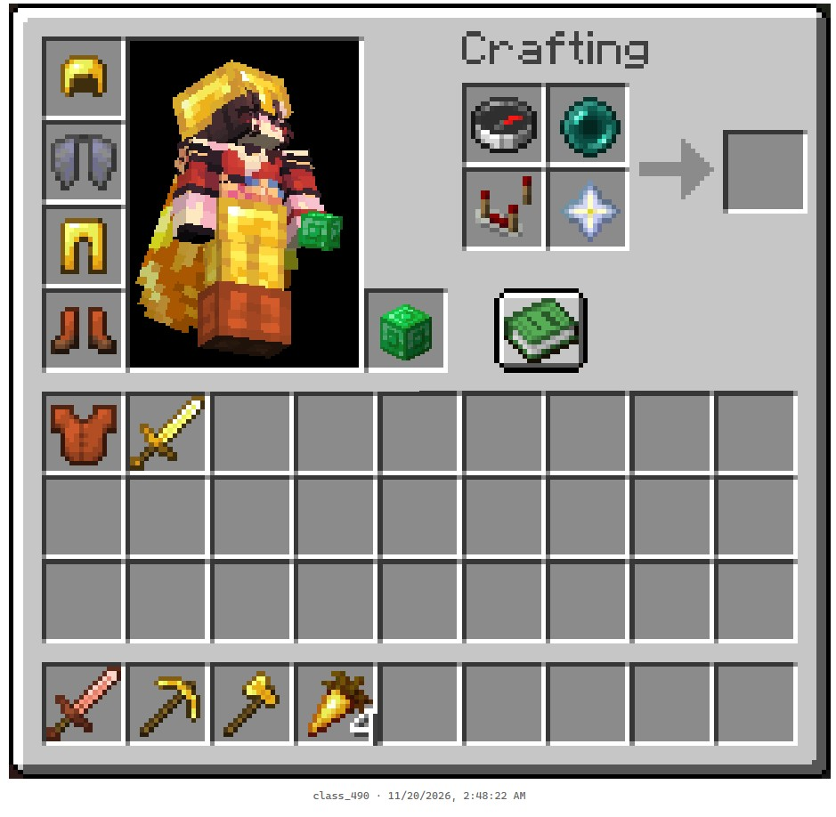
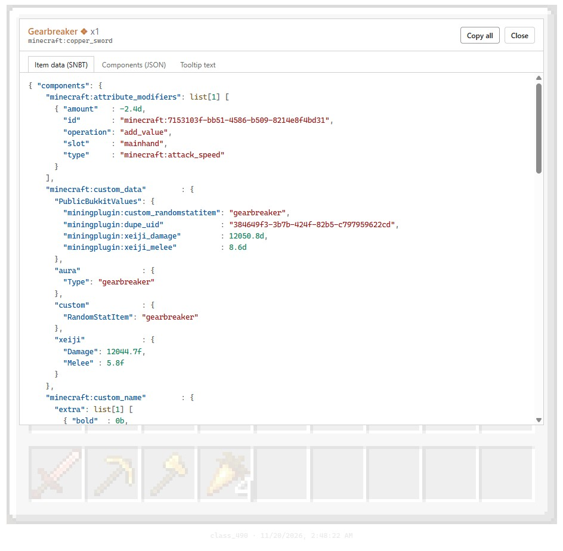

# MCInv to HTML

A client-side **Fabric mod** for **Minecraft 1.21.11** that exports any inventory screen to a
**single, self-contained, read-only HTML file** — a pixel-perfect snapshot you can open in any
browser, offline.

Hover items to see the exact in-game tooltip, click an item to inspect its full data, or click the
title to see its component JSON.





## Features

- **"Export" button** on every container screen — chests, barrels, hoppers, furnaces, shulkers,
  dispensers, crafting tables, villager trades, the player inventory, and more.
- **Pixel-perfect panel** — captured straight from the framebuffer, so backgrounds, item icons,
  3D item models, enchantment glint, stack counts, and durability bars look exactly like the game.
- **Read-only snapshot** — no live data, no network access, everything is embedded in one `.html`
  file as a base64 PNG + JSON.
- **Hover tooltips** — rebuilt from the real tooltip lines, including colors, bold/italic/underline
  styling, enchantments, lore, and attributes.
- **Click an item** — opens a modal with:
  - Full **SNBT** item data (components, formatted like `/data get`), syntax highlighted
  - **Components JSON**
  - **Tooltip text**
- **Click the title** — opens a modal with the title component JSON, the player-inventory title, and
  screen metadata.
- **Text you can use** — selectable code, native `Ctrl/Cmd+C`, and a **Copy all** button per tab.
- Creative inventory is intentionally skipped.

## Requirements

| Component | Version |
|-----------|---------|
| Minecraft | 1.21.11 |
| Fabric Loader | 0.20.1+ |
| Fabric API | 0.141.6+1.21.11 |
| Java | 21+ |

## Installation

1. Install [Fabric Loader](https://fabricmc.net/use/) for Minecraft 1.21.11.
2. Drop [Fabric API](https://modrinth.com/mod/fabric-api) and the `mcinvtohtml-1.0.0.jar` into your
   `mods/` folder.
3. Launch the game.

## Usage

1. Open any container (or your own inventory).
2. Click the **Export** button at the top-right of the window.
3. A chat message confirms the file path. Click it to open the file, or find it at:

   ```
   .minecraft/mcinvtohtml/<inventory>_<yyyy-MM-dd_HH-mm-ss>.html
   ```

4. Open the `.html` in any browser. Everything works offline.

> While exporting, the hover tooltip, the item held on the cursor, and the slot highlight are
> temporarily suppressed so they do not appear in the snapshot. The carried item is not exported.

## How it works

- A mixin adds the **Export** button in `AbstractContainerScreen#init`.
- Inventory data (title, slot layout, item stacks, tooltip spans, component SNBT/JSON) is collected
  and serialized to JSON.
- On the next rendered frame, the GUI region is captured from the main render target
  (`Screenshot.takeScreenshot`), cropped to the panel bounds, and embedded as a base64 PNG.
- A bundled HTML template (`viewer.html`) is populated with the JSON and written to disk — a single
  file with no external dependencies.

Large or heavily-nested item data is preserved in full. Above ~150 KB the viewer renders the text
plain instead of syntax-highlighting it to keep the browser responsive; **Copy all** still copies the
complete data.

## Building from source

```bash
./gradlew build
```

The jar is produced at `build/libs/mcinvtohtml-1.0.0.jar`.

To run a development client:

```bash
./gradlew runClient
```

## Project layout

```
src/main/java/com/namvuive/mcinvtohtml/
  MCInvToHtmlClient.java                       client initializer
  mixin/AbstractContainerScreenMixin.java      adds the Export button
  mixin/AbstractContainerScreenCaptureMixin.java   suppresses UI while capturing
  mixin/AbstractContainerScreenAccessor.java   protected field accessors
  mixin/ScreenAccessor.java                    addRenderableWidget invoker
  mixin/GameRendererMixin.java                 capture trigger at end of frame
  export/InventoryExporter.java                collects slots, tooltips, components -> JSON/SNBT
  export/ExportManager.java                    capture orchestration, crop, write, feedback
  export/HtmlWriter.java                       loads the template and injects data
src/main/resources/
  fabric.mod.json
  mcinvtohtml.client.mixins.json
  assets/mcinvtohtml/icon.png
  assets/mcinvtohtml/templates/viewer.html     self-contained HTML viewer
```

## License

MIT — see [LICENSE](LICENSE). Author: **namvuive**.
